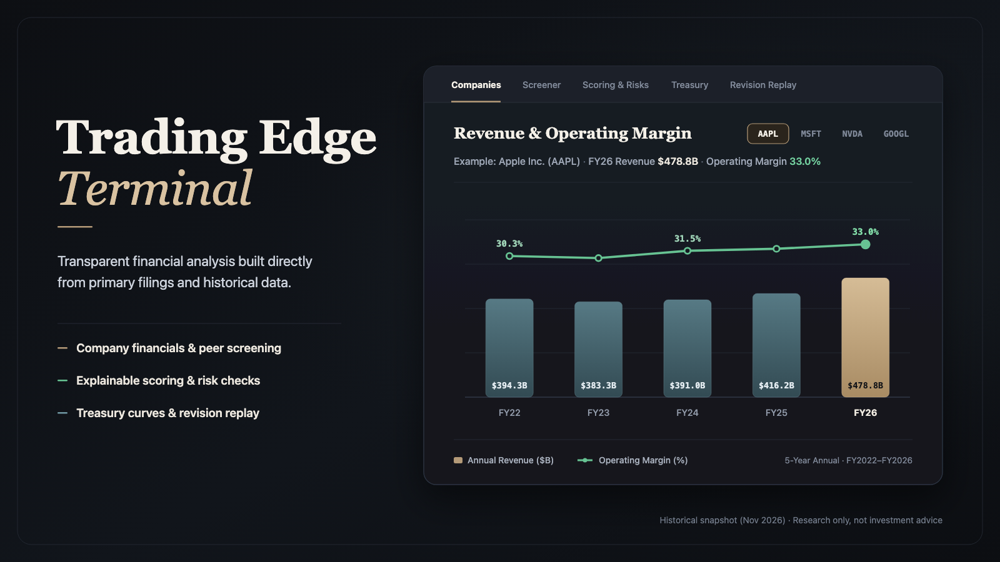

# Trading Edge Terminal



**Trading Edge Terminal** is a transparent financial research workspace built around primary corporate filings and historical market data. It brings multi-year company analysis, peer screening, explainable accounting scores, risk checks, U.S. Treasury yield context, and point-in-time revision replay into one cohesive workflow.

> **Interactive Browser Preview:** [https://erturkeryavuz.github.io/trading-edge-terminal-demo/](https://erturkeryavuz.github.io/trading-edge-terminal-demo/) — static browser preview hosted via GitHub Pages (also runnable locally via the command below).

---

## Core Capabilities

- **Company Fundamental Analysis:** Examines Trailing Twelve Months (TTM) and multi-year Annual (`FY`) financial statements across 17 U.S. operating companies (`AAPL`, `MSFT`, `NVDA`, `AMZN`, `GOOGL`, `ORCL`, `WMT`, `COST`, `CSCO`, `ADBE`, `PG`, `HD`, `CRM`, `INTC`, `TXN`, `KO`, `AMD`), separating `[REPORTED]` SEC EDGAR XBRL disclosures from `[DERIVED]` metrics, tracking YoY change drivers, and linking directly to official filings. `SPY` is included to demonstrate explicit ETF/fund non-imputation boundaries.
- **Company Screener & Peer Comparison:** Evaluates four built-in accounting presets (`Balance-Sheet Strength`, `Cash Flow Quality`, `Financial Deterioration Watch`, `Growth & Profitability`), `TTM` vs. `Latest FY` period modes, custom numeric/boolean filters, sortable columns, and multi-company peer comparison with automatic fiscal-period offset warnings (`> 45` days).
- **Explainable Accounting Score:** Transparent `0–100` seven-component GAAP research heuristic showing every component weight, observed accounting input, missing-weight exclusion (zero fabricated imputation), and side-by-side two-company component delta breakdown.
- **Filing-Backed Risk Inspector:** Structured accounting risk findings reporting each rule's measurement criteria, caveats, verification steps, reporting periods, and official SEC filing links.
- **U.S. Treasury Yield Curve Context:** Full 13-tenor (`1M`–`30Y`) Daily Treasury Par Yield Curve (`2026-11-10`) paired with a 260-day interactive historical trajectory scrubber tracking `10Y`, `2Y`, `3M` rates and exact `10Y–2Y` / `10Y–3M` spreads.
- **Point-in-Time Observation & Revision Replay:** Demonstrates strict anti-lookahead replay on a synthetic 1-minute OHLCV ledger (`fixture:TEST`) with idempotent duplicate handling, delayed bar corrections (`12 → 15`), bounded NYSE `2026–2027` Regular Trading Hours calendar rules (`US-RTH-2026-2027/v1`), and side-by-side **As-Of** vs. **Latest** breakout evaluation.

---

## Technology Stack

- **Original Local-First Engine (Private Repository):** Python 3.9+ standard library only (`sqlite3`, `decimal`, `urllib`, `zoneinfo`, `http.server`), SQLite persistence with exact `Decimal` text storage, SHA-256 cached federal HTTP acquisition (`<= 4 req/s`), and a `127.0.0.1`-only loopback workstation server with CSRF and `Host`/`Origin` enforcement.
- **Static Browser Preview (This Repository):** Zero-dependency HTML5, CSS3, vanilla JavaScript, and data-grounded SVG charts running entirely client-side from deterministic exported fixtures.

---

## Architecture & Engineering Decisions

- **Strict Separation of Source and Preview:** The original Python/SQLite workstation repository remains private and frozen; its backend engine, local database, and loopback HTTP API do not execute inside this static browser preview. All browser workflows operate client-side against verified exported snapshots.
- **Exact Financial Representation:** Financial metrics, Treasury yields, spreads, and synthetic OHLCV bars follow exact `Decimal` string contracts in the underlying Python/SQLite platform to avoid binary floating-point drift in cash-flow, net-debt, spread, and breakout calculations.
- **Non-Imputation by Design:** Non-operating exchange-traded funds (`SPY`) and missing accounting criteria are explicitly flagged (`insufficient_data` or excluded from evaluated denominators) rather than filled with placeholder values.
- **Anti-Lookahead Revision Provenance:** Observation histories are append-only. Querying `as-of` projects only revisions known at or before the cutoff timestamp while retaining complete revision lineage in the audit ledger.

---

## Analytical Methodology

1. **Statement Normalization:** Combines restated `10-K`/`10-Q` XBRL facts with standalone quarterly rollforwards (`TTM`) and annual fiscal periods (`FY`), recording exact formulas for derived fields (`Free Cash Flow = Operating Cash Flow - CapEx`, `Net Debt = Total Debt - Cash & Short-Term Investments`).
2. **Accounting Score Weights:** Evaluates seven transparent GAAP categories totaling 100 points: Growth Consistency (`20`), Profitability (`20`), Cash Flow Quality (`20`), Balance-Sheet Health (`15`), Financial Trend Stability (`10`), Risk Flags (`10`), and Data Completeness (`5`). Scores are strictly descriptive historical summaries—not buy/sell/hold recommendations or return forecasts.
3. **Breakout Replay Rule:** Evaluates `close[t] > max(high[t-3], high[t-2], high[t-1])` only across four contiguous eligible bars in the same stream and RTH session. Equality does not qualify, and any gap, quality flag, or session boundary resets lookback readiness.

---

## Explore Locally

No build step, API key, or third-party package installation is required:

```bash
python3 -m http.server 8000 --directory docs
# Open http://127.0.0.1:8000/
```

Use the top navigation tabs (`Overview`, `Companies`, `Screener`, `Scoring & Risks`, `Treasury`, `Revision Replay`, `Architecture`) to explore manually, or launch the optional **Watch Tutorial** from the header for a guided 7-step walkthrough with sticky playback controls and automatic session restoration on exit.

---

## Data Provenance & Limitations

- **Historical Snapshot Only:** Active feature development of Trading Edge Terminal is frozen. SEC EDGAR corporate fundamentals (2026-11-12) and U.S. Treasury par yield rates (2026-11-10, with historical observations from 2025-10-28) are fixed historical snapshots and do not refresh live. The SEC dataset contains extracted factual accounting figures and filing metadata, while Treasury statistical publications are generally U.S. federal government works.
- **No Stock Prices, Forecasts, or Brokerage Execution:** Trading Edge Terminal focuses on structured fundamental research, Treasury macro context, and deterministic observation provenance. It does not include live stock quotes, valuation multiples, machine-learning price predictions, brokerage routing, or claims of trading profitability.
- **Synthetic Replay Fixture:** All 1-minute bar prices and breakout evaluations in *Revision Replay* are fabricated integers (`fixture:TEST`) illustrating point-in-time determinism.
- **Not Investment Advice:** All analytics, screening presets, scores, and risk rules are provided for software engineering and financial research demonstration only.

---

## Testing & Reproducibility

- **Standalone Public Preview Verification:** Run the deterministic offline test suite (Python 3.9+ standard library and Node.js syntax/contract verification; requires no private repository or network calls):

```bash
python3 -B -m unittest discover -s tests -p "test_*.py" -v
python3 -B tests/verify_demo.py -v
```

- **Original Private Repository Verification Record:** The frozen private engineering repository recorded `250 / 250` passing offline standard-library `unittest` cases across observation validation, revision replay, SQLite persistence, SEC EDGAR/Treasury parsing, screening, scoring, and loopback server security.

---

## Attribution & Licensing

- Complete data-source attribution, redistribution basis, and non-affiliation notices are published in [`docs/THIRD-PARTY-NOTICES.md`](docs/THIRD-PARTY-NOTICES.md) and [`docs/notices.html`](docs/notices.html).
- No root open-source `LICENSE` file is declared without separate owner authorization.
